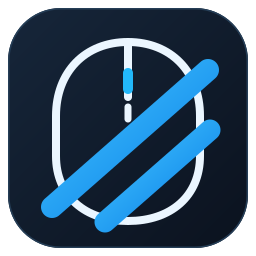

<p align="center">
  
</p>

# CLON//CONTROL

**El clon responde.** Un configurador liviano para un mouse que se parece a un Razer, pero no lo es.

[Descargar compilaciones](https://github.com/vanTheodore/Razer_Config/releases) · [Código fuente](https://github.com/vanTheodore/Razer_Config) · [Historial](CHANGELOG.md) · [Licencia MIT](LICENSE)

> **Importante:** CLON//CONTROL es una herramienta independiente para Windows 10/11 y **no tiene relación con Razer**. Solo reconoce `18F8:1286` con la colección HID de configuración esperada. No instala controladores ni modifica firmware.

## Lo que puedes hacer hoy

**Cambiar el DPI del mouse.** Esa es la razón de existir del proyecto: el propietario confirmó un **cambio físico observable de sensibilidad** en su unidad `INSTANT 18F8:1286`. El programa ofrece cuatro perfiles con valores **nominales** de 200–3000 CPI, en pasos de 200. No mide ni garantiza la precisión absoluta del sensor ni la conservación del ajuste tras desconectarlo.

1. Descarga el ZIP portable de Windows desde [Releases](https://github.com/vanTheodore/Razer_Config/releases) o desde el artefacto de una PR que estés probando.
2. Descomprime y ejecuta `cloncontrol.exe`.
3. Elige un perfil, ajusta la sensibilidad y pulsa **Aplicar DPI al mouse**.

Listo. Sin «Simular», sin autorización duplicada y sin escribir mientras mueves los deslizadores. **Guardar perfiles** solo guarda la configuración local. La operación «Aplicar DPI» envía únicamente los cuatro reportes DPI `07 09` y deja fuera RGB, botones y rueda.

## Estado real de las funciones

| Función | Estado | Qué sabemos |
|---|---|---|
| Detectar `18F8:1286` | Comprobado | Se identifica `MI 1 / FF01:0001`, Feature Report `07`. |
| Cambiar DPI | **Comprobado en hardware** | El usuario observó una diferencia real en la velocidad del cursor. CPI exactos no medidos. |
| Leer datos HID de diagnóstico | Comprobado | `GetFeature` respondió en las pruebas reales con buffers de 8 y 32 bytes. |
| Iluminación | **Sin resultado físico** | Windows aceptó la solicitud de apagado, pero la luz no cambió. |
| Botones laterales | Experimental | Reportes documentados; efecto no comprobado en esta unidad. |
| Rueda | Experimental | Reportes documentados; efecto no comprobado en esta unidad. |
| Secuencias `07 1C` / `07 20` | Investigación | Su función y bytes efectivos no están demostrados. **No se activan automáticamente.** |

La pantalla **Otras funciones** separa las operaciones no verificadas del DPI y requiere una confirmación específica. Si una función no produce efecto, no la presentaremos como exitosa solo porque Windows aceptó la escritura USB.

## Identidad

- **Nombre:** CLON//CONTROL.
- **Lema:** *El clon responde.*
- **Símbolo:** un mouse atravesado por dos trazos azules. La doble barra no es un error tipográfico: es la firma del clon.
- **Diseño:** azules eléctricos, superficies nocturnas, iconos geométricos dibujados en egui. No dependen de emoji ni de fuentes especiales de Windows.
- **Principio de UX:** lo probado va primero; lo experimental, claramente identificado y separado.

> No es Synapse. Tampoco pretende serlo. Es el pequeño programa que logró cambiar el DPI de un mouse falsificado.

## Requisitos y privacidad

- Windows 10/11 x64.
- Mouse HID identificado como `18F8:1286` con la colección `MI 1 / FF01:0001` y Feature Report `07` de ocho bytes.
- No requiere servicio residente, cuenta, nube ni instalación de un driver adicional.
- Los perfiles locales están en `%LOCALAPPDATA%\ClonControl\a704f.json`.
- El último resultado de escritura HID se registra en `%LOCALAPPDATA%\ClonControl\ultima_prueba_hid.txt`, sin rutas USB ni números de serie. El registro no constituye una medición física de DPI.
- Toda escritura exige una acción expresa. El programa revalida la interfaz HID antes de transmitir.

**No es un programa universal** para todos los clones, ni para todos los firmwares Instant A704F. El VID/PID compartido por otros modelos no garantiza compatibilidad.

## Para investigar problemas

La pestaña **Diagnóstico** muestra el canal identificado, previsualiza reportes y permite copiar el último registro de Windows. `a704f-diag.exe` inspecciona colecciones HID sin escribir; la sonda `--probe-07` ejecuta lecturas opcionales. `a704f-trace.exe` analiza capturas exportadas de USB de forma *offline*.

El análisis del software propietario Instant y las diferencias encontradas en Rexus X8 están documentados en:

- [Software Instant y restauración del PE](docs/INSTANT_CALL_TARGET_AUDIT.md).
- [Ingeniería inversa estática](docs/INSTANT_STATIC_REVERSE_ENGINEERING.md).
- [Referencia USB y capturas](docs/INSTANT_REFERENCE.md).
- [Investigación Rexus X8 — issue #9](https://github.com/vanTheodore/Razer_Config/issues/9).

No se redistribuyen ejecutables ni firmware OEM.

## Desarrollar

Proyecto Rust, GUI nativa con **egui/eframe**, transporte HID mediante **hidapi (windows-native)**. Las dependencias directas y el compilador mínimo se declaran en `Cargo.toml` y `rust-toolchain.toml`.

```powershell
cargo test --all-targets
cargo clippy --all-targets -- -D warnings
cargo build --release --bins
```

GitHub Actions ejecuta las pruebas en Windows MSVC y adjunta ZIPs portables para las PR; la rama `main` publica compilaciones *prerelease* experimentales. Un CI verde no sustituye la prueba física del propietario.

## Organización del repositorio

El historial publicado de `main` se conserva intacto: los cambios nuevos se integran mediante **squash merge** y se resumen en [CHANGELOG.md](CHANGELOG.md). La automatización [Prune merged topic branches](.github/workflows/prune-merged-branches.yml) limpia, después de nuevas integraciones, únicamente ramas `feature/`, `fix/`, `research/` y `chore/` pertenecientes a PR fusionadas cuyo HEAD no haya cambiado; protege `main`, ramas con PR abiertas y trabajo nuevo. Puede ejecutarse manualmente en modo de vista previa.

## Contribuir y alcance

Se agradecen reportes de hardware con **VID/PID, colección HID, comando enviado y resultado físico** (sin compartir seriales, rutas USB ni capturas de teclas). Prioridades: DPI fiable, interfaz clara y diagnósticos reproducibles. No introducir comandos especulativos ni afirmar compatibilidad sin prueba de hardware.

La [PR #8](https://github.com/vanTheodore/Razer_Config/pull/8) mantiene propuestas experimentales separadas. Este rediseño no la integra ni valida automáticamente esas funciones.

**Licencia:** [MIT](LICENSE). Documentación ajena de protocolo acreditada a [AmberIsFrozen](https://github.com/AmberIsFrozen/Instant-A704F-Mouse-Utilities).

---

*Razer Synapse no reconoce este mouse. CLON//CONTROL, al menos, consiguió cambiarle el DPI.* 🦀
